  

---

## 🛰️ About Me

I'm an M.Sc. Social and Economic Data Science student at the University of Konstanz, Germany, with a background in behavioural research and statistical modelling.

Alongside my studies, I work as a Software Developer at w3 data, contributing to the development of existing weather-data processing systems and exploring new methods for processing meteorological data.

My technical interests span Machine Learning, Deep Learning, and Computer Vision, particularly object detection, image analysis, and the application of AI to complex real-world data. I'm also interested in geospatial and remote-sensing applications, alongside broader developments in applied AI.

---

## 🧰 Tech Stack

**Languages**

**Machine Learning & Computer Vision**

**Generative AI**

**Deployment & Tooling**

---

## 🎯 Areas of Interest

- 👁️ **Computer Vision**: object detection and image analysis
- 🧠 **Machine & Deep Learning**: applying AI to complex real-world data
- 🛰️ **Geospatial & Remote Sensing**: satellite imagery and earth-observation applications
- 🌦️ **Meteorological Data**: new methods for processing weather data
- ⚙️ **Applied AI**: following and experimenting with broader developments

---

🌌 *"The Earth is the cradle of humanity, but one cannot live in a cradle forever."* · Tsiolkovsky

